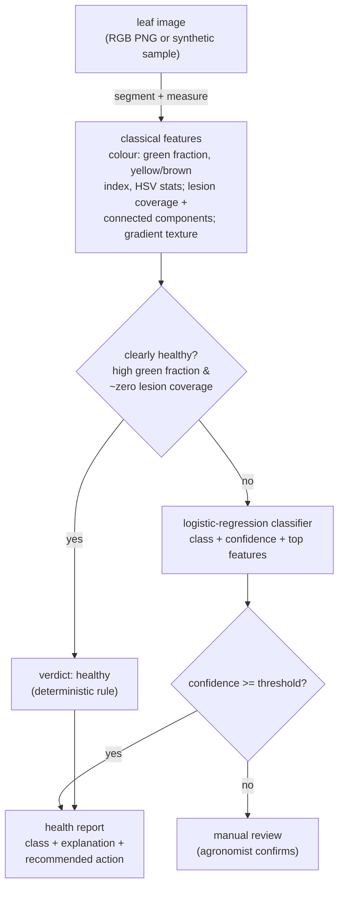

# AgroVision

Offline, deterministic crop-leaf health assessment from leaf images, using
**classical computer vision** — no pretrained model, no downloads, no network.
It renders synthetic leaves, extracts hand-defined colour and texture features,
and classifies each leaf as `healthy`, `chlorosis` (yellowing), `blight`
(necrotic patches) or `rust` (orange-brown spots), with an explanation and a
recommended action. The evaluation is honest: it holds out whole parameter
ranges so the reported number reflects real generalisation, not a memorised 1.0.

[](.github/workflows/ci.yml)
[](pyproject.toml)
[](LICENSE)

---

## Why it matters

Most "AI plant doctor" demos reach for a pretrained CNN and report ~99%
accuracy on a split of the same curated dataset — a number that says little about
a leaf photographed in a real field. AgroVision takes the opposite, honest
stance for a portfolio piece: it stays fully offline and deterministic, uses only
features a plant pathologist could name and read off the leaf, and it measures
itself on **unseen** leaf appearances. The result is a lower but *trustworthy*
number, and a system whose every verdict can be explained and overruled.

## How it works



1. **Generator (`generate.py`).** Renders RGB leaves with NumPy: an ellipse leaf
   with veins, class-specific colouring, lesions (size/count varied), lighting
   and noise. Disease pattern knobs are drawn from banded ranges so an honest
   split can hold whole bands out of training.
2. **Features (`features.py`).** Segments the leaf from the background by
   saturation (robust to lighting), then measures colour statistics (green
   fraction, a yellowing index, HSV hue/saturation), lesion coverage and its
   connected-component geometry (`scipy.ndimage` — *many small* rust spots vs
   *few large* blight patches), and a gradient-variance texture feature.
3. **Classifier (`classifier.py`).** A `StandardScaler` + multinomial logistic
   regression over those features. Being linear, each verdict ships with the
   features that drove it. A deterministic **rule** short-circuits the obviously
   healthy leaf (high green fraction, no lesions) without consulting the model.
4. **Service (`service.py`).** Decodes a leaf (base64 PNG or a sample id),
   assesses it, and returns the class, confidence, explanation and the
   recommended agronomic action.

## Quick start

```bash
python -m venv .venv && source .venv/bin/activate
pip install -e ".[dev]"

python -m agrovision.cli demo          # render one leaf per class, classify, show verdicts
python -m agrovision.evaluation        # the honest, parameter-disjoint accuracy
uvicorn agrovision.main:app --reload   # HTTP API
```

Example API calls:

```bash
# Generate a sample leaf and assess it (true label echoed back)
curl -s -X POST localhost:8000/assess-sample -H 'content-type: application/json' \
  -d '{"label": "rust", "seed": 3}'

# Assess your own leaf image (base64-encoded PNG)
curl -s -X POST localhost:8000/assess -H 'content-type: application/json' \
  -d "{\"image_base64\": \"$(base64 -w0 leaf.png)\"}"

# A base64 PNG sample you can feed back into /assess
curl -s localhost:8000/sample/chlorosis
```

## Configuration

Settings load from environment variables with the `AV_` prefix (see
`.env.example`):

| Variable                       | Default | Meaning                                                  |
| ------------------------------ | ------- | -------------------------------------------------------- |
| `AV_CLASSIFIER_MIN_CONFIDENCE` | `0.55`  | Below this, a verdict is routed to manual review         |
| `AV_RULE_GREEN_FRACTION`       | `0.47`  | Green fraction at/above which the healthy rule may fire  |
| `AV_RULE_MAX_SPOT_COVERAGE`    | `0.02`  | Lesion coverage at/below which the healthy rule may fire |

## Evaluation: honest generalisation, measured on unseen parameters

The four classes are genuinely distinct — the colour signatures a plant
pathologist would describe (green; yellowed; a few large **brown** necrotic
patches; many small **orange** pustules) — so a sound classical classifier should
separate them well. The honest question is not "can it fit the training look?"
but "does it generalise to leaf appearances it has not seen?", and that is what
is measured: every generation knob (lesion size, lesion count, chlorosis
severity, lighting) is cut into interleaved bands, and `agrovision.evaluation`
trains on one set of bands and tests on the **disjoint** bands — no test leaf's
spot size, count, severity or lighting was ever seen in training.

```
$ python -m agrovision.evaluation
  accuracy (mean+/-std over 5 seeds): 0.99 +/- 0.01   # four classes; chance ~0.25; parameters unseen in training
  macro-F1 (mean over 5 seeds)      : 0.99
  train accuracy                      : 1.00
  train-test gap                      : 0.01   # ~0 -> real generalisation, not a memorised synthetic look
```

What this number does and does not claim, stated plainly:

- The honesty is **not** an accuracy cap — it is the **near-zero train/test gap on
  disjoint parameters**. A high score *with* a ~0.01 gap on sizes/counts it never
  saw means the model learned the colour/geometry of each disease, not a fixed
  synthetic look. (A high score with a *large* gap would be the memorisation trap;
  this is the opposite.) The command averages over several seeds so the figure is
  robust rather than one lucky split.
- It does **not** claim field-ready performance. This is a **synthetic
  benchmark**: real leaves bring occlusion, soil and sky background, wet/dry
  variation, mixed and co-occurring diseases, and camera differences that no
  renderer captures — the problem is genuinely harder there. A production system
  would train a CNN on **real, labelled field imagery** and report against that,
  treating this held-out score as the baseline to beat, not the ceiling.

Because the model can be wrong, low-confidence verdicts are routed to review, and
the clearly-healthy leaf is handled by a stated deterministic rule rather than a
weight vector.

## Testing

```bash
ruff check agrovision tests
pytest --cov=agrovision --cov-report=term-missing --cov-fail-under=80
```

The suite covers the feature extraction (one assertion per class signature, the
leaf/lesion masks and the HSV conversion), the classifier (each class, the
healthy rule fallback, low-confidence review, the explanation), the honest
held-out thresholds with a bounded gap (and an assertion that the accuracy is
*not* a leaky ~1.0), the HTTP API, and the CLI demo.

## Documentation

- `docs/architecture.md` — components, data flow, and the design rationale.
- `docs/adr/` — the main design decisions and their trade-offs.
- `docs/estudio/` — a study guide in Spanish, for learning the project in depth.

## A note on scope

AgroVision is a reference implementation, not a field diagnostic tool. It
demonstrates a clean, explainable classical-CV pipeline with an honest
evaluation. A production system would be trained and evaluated on real labelled
field photographs with a convolutional network, add proper leaf segmentation for
cluttered scenes, handle multiple co-occurring diseases and severity grading, and
report against that real-world held-out set.

## License

[MIT](LICENSE) © Angelo David Padilla Romero
