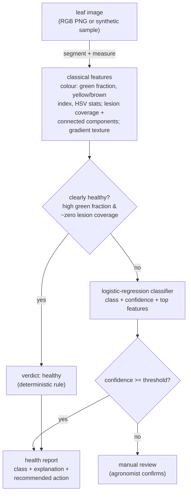

# AgroVision

Crop-leaf health assessment from leaf images using **classical computer vision** —
no pretrained model, every feature hand-defined and readable. It classifies a leaf
as `healthy`, `chlorosis` (yellowing), `blight` (necrotic patches) or `rust`
(orange-brown spots), with an explanation and a recommended action. It is evaluated
two ways: on a controlled synthetic generator with **overlapping classes** and a
**parameter-disjoint** split (realistic ~0.90, not a memorised 1.0), and on **real
field photographs** (the Makerere Beans dataset) to measure the same features on
real imagery. The core pipeline is offline and deterministic; the real-image
benchmark uses a small vendored subset (refreshable from Hugging Face).

[](.github/workflows/ci.yml)
[](pyproject.toml)
[](LICENSE)

---

## Why it matters

Most "AI plant doctor" demos reach for a pretrained CNN and report ~99%
accuracy on a split of the same curated dataset — a number that says little about
a leaf photographed in a real field. AgroVision takes the opposite, disciplined
stance for a portfolio piece: it uses only features a plant pathologist could name
and read off the leaf, it measures itself on **unseen** leaf appearances, and it
reports the result on **real** field photos too. The numbers are lower but
trustworthy, and every verdict can be explained and overruled.

## How it works



1. **Generator (`generate.py`).** Renders RGB leaves with NumPy: an ellipse leaf
   with veins, class-specific colouring, lesions (size/count varied), lighting
   and noise. Disease pattern knobs are drawn from banded ranges so a trustworthy
   split can hold whole bands out of training.
2. **Features (`features.py`).** Segments the leaf from the background by
   saturation (robust to lighting), then measures colour statistics (green
   fraction, a yellowing index, HSV hue/saturation), lesion coverage and its
   connected-component geometry (`scipy.ndimage` — *many small* rust spots vs
   *few large* blight patches), and a gradient-variance texture feature.
3. **Classifier (`classifier.py`).** A `StandardScaler` + multinomial logistic
   regression over those features. Being linear, each verdict ships with the
   features that drove it. A deterministic **rule** short-circuits the obviously
   healthy leaf (high green fraction, no lesions) without consulting the model.
4. **Service (`service.py`).** Decodes a leaf (base64 PNG or a sample id),
   assesses it, and returns the class, confidence, explanation and the
   recommended agronomic action.

## Quick start

```bash
python -m venv .venv && source .venv/bin/activate
pip install -e ".[dev]"

python -m agrovision.cli demo          # render one leaf per class, classify, show verdicts
python -m agrovision.evaluation        # the leakage-free, parameter-disjoint accuracy
uvicorn agrovision.main:app --reload   # HTTP API
```

Example API calls:

```bash
# Generate a sample leaf and assess it (true label echoed back)
curl -s -X POST localhost:8000/assess-sample -H 'content-type: application/json' \
  -d '{"label": "rust", "seed": 3}'

# Assess your own leaf image (base64-encoded PNG)
curl -s -X POST localhost:8000/assess -H 'content-type: application/json' \
  -d "{\"image_base64\": \"$(base64 -w0 leaf.png)\"}"

# A base64 PNG sample you can feed back into /assess
curl -s localhost:8000/sample/chlorosis
```

## Configuration

Settings load from environment variables with the `AV_` prefix (see
`.env.example`):

| Variable                       | Default | Meaning                                                  |
| ------------------------------ | ------- | -------------------------------------------------------- |
| `AV_CLASSIFIER_MIN_CONFIDENCE` | `0.55`  | Below this, a verdict is routed to manual review         |
| `AV_RULE_GREEN_FRACTION`       | `0.47`  | Green fraction at/above which the healthy rule may fire  |
| `AV_RULE_MAX_SPOT_COVERAGE`    | `0.02`  | Lesion coverage at/below which the healthy rule may fire |

## Evaluation: leakage-free generalisation, measured on unseen parameters

The classes **overlap on purpose**: rust and blight share a wide colour band and
their lesion counts/sizes overlap, and every diseased leaf has a *severity* (an
early-stage lesion is faint and sparse, close to a healthy leaf). So a share of
leaves are genuinely ambiguous and the ceiling is well below 1.0 — rust vs blight
is the pair that gets confused. On top of that, the evaluation is parameter-
disjoint: every generation knob (lesion size/count, chlorosis severity, lighting)
is cut into interleaved bands, and `agrovision.evaluation` trains on one set of
bands and tests on the **disjoint** bands, so no test leaf's size, count, severity
or lighting was seen in training.

```
$ python -m agrovision.evaluation
  accuracy (mean+/-std over 5 seeds): 0.90 +/- 0.03   # four classes; chance ~0.25; parameters unseen in training
  macro-F1 (mean over 5 seeds)      : 0.89
  train accuracy                      : 0.86
  train-test gap                      : -0.04   # ~0 -> learns features, not a fixed synthetic look
```

The ~0.90 is realistic, not a suspicious 1.0, and the near-zero train/test gap
shows it is not overfitting either: the model learned the colour/geometry of each
disease on parameter bands it never saw. (Remove the overlapping confounders and
the accuracy jumps straight back to 1.0 — a regression test guards against that.)

### Validated on real leaf images

The synthetic set gives a controlled, 4-class, parameter-disjoint measurement; the
real **Makerere Beans** dataset (180 field photos, vendored under `datasets/beans/`)
checks the same features on real imagery. `python -m agrovision.real_benchmark`:

```
model                    CV accuracy        train    test     gap
Logistic (regularised)   0.672 +/- 0.051     0.733   0.711   0.022
Random forest            0.667 +/- 0.046     1.000   0.667   0.333   # memorises, no CV gain
```

On real leaves the hand-defined features reach ~0.67 (3 classes, chance 0.33) with
a well-fit logistic model; enriching to 66 features (HSV histograms, LBP and GLCM
texture) and an RBF-SVM reaches only ~0.72. That is the ceiling of interpretable
features on real field variation — the case for a learned CNN
([ADR-0001](docs/adr/0001-classical-cv-not-pretrained-cnn.md)), which this baseline
exists to be measured against. Because the model can be wrong, low-confidence
verdicts are routed to review and the clearly-healthy leaf is handled by a stated
deterministic rule.

## Testing

```bash
ruff check agrovision tests
pytest --cov=agrovision --cov-report=term-missing --cov-fail-under=80
```

The suite covers the feature extraction, the classifier (each class, the healthy
rule fallback, low-confidence review, the explanation), the parameter-disjoint
held-out accuracy (with a regression guard that fails if the overlapping
confounders are removed and the score returns to ~1.0, mutation-proven), the
**real-image benchmark** (the Beans loader, the well-fit logistic vs overfitting
forest, and a shuffled-label collapse to chance), the HTTP API, and the CLI demo.

## Documentation

- `docs/architecture.md` — components, data flow, and the design rationale.
- `docs/adr/` — the main design decisions and their trade-offs.
- `docs/estudio/` — a study guide in Spanish, for learning the project in depth.

## A note on scope

AgroVision is a reference implementation, not a field diagnostic tool. It
demonstrates a clean, explainable classical-CV pipeline with a trustworthy
evaluation. A production system would be trained and evaluated on real labelled
field photographs with a convolutional network, add proper leaf segmentation for
cluttered scenes, handle multiple co-occurring diseases and severity grading, and
report against that real-world held-out set.

## License

[MIT](LICENSE) © Angelo David Padilla Romero
