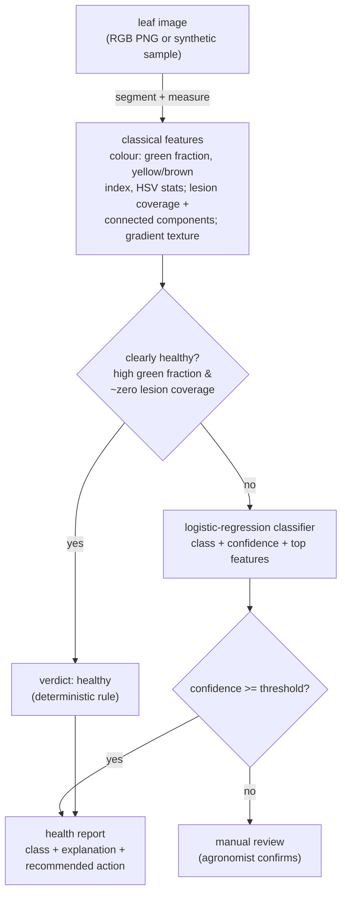

# Architecture

AgroVision is a classical computer-vision pipeline: a synthetic image generator,
a hand-defined feature extractor, an explainable linear classifier with a
deterministic rule in front of it, and thin service / API / CLI layers. It is
fully offline and deterministic — no pretrained weights, no network — so every
result is reproducible from a seed.

## Components

| Component    | File                       | Responsibility                                               |
| ------------ | -------------------------- | ------------------------------------------------------------ |
| Generator    | `agrovision/generate.py`   | Synthetic labelled leaf images; parameter-banded honest split |
| Features     | `agrovision/features.py`   | Leaf segmentation + classical colour/texture features        |
| Classifier   | `agrovision/classifier.py` | Features → health class, with rule fallback and explanation  |
| Evaluation   | `agrovision/evaluation.py` | Honest, parameter-disjoint generalisation measurement        |
| Service      | `agrovision/service.py`    | Orchestration + PNG/base64 edge + sample bank                |
| HTTP API     | `agrovision/main.py`       | REST surface over the service                                |
| CLI          | `agrovision/cli.py`        | End-to-end demo                                              |
| Config       | `agrovision/config.py`     | `AV_`-prefixed settings (thresholds)                         |

## Data flow

## Why classical computer vision (and not a CNN)

A convolutional network would almost certainly beat these features on *real*
leaves. But a portfolio project that downloads pretrained weights and reports a
split-of-the-same-dataset accuracy teaches nothing and hides everything. Classical
CV forces every decision into the open: the leaf is segmented by a stated
saturation rule, each feature is a named statistic with a documented meaning, and
the classifier is linear so its verdicts are explained by feature contributions.
The honest limitation — that this is a synthetic benchmark and a CNN on real
imagery is the production path — is stated plainly rather than papered over by a
big number. See ADR 0001.

## Why synthetic images

With no licensed field dataset and a hard offline constraint, the data is
rendered. That is a real limitation, owned openly (ADR 0002), but it also buys
something valuable for honesty: because we *control* the generative parameters,
we can hold whole parameter ranges out of training and ask the genuinely hard
question — does the model generalise to leaf appearances it has never seen?

## Why the evaluation holds out parameter ranges

A within-distribution split (train and test drawn from the same parameter
distribution) would report a meaningless number: even a model that merely
memorised the fixed synthetic look would score high. So the split is
**parameter-disjoint** — each generation knob (lesion size, count, chlorosis
severity, lighting) is cut into interleaved bands, training draws from one set and
testing from the disjoint complement, so no test leaf's lesion size, count,
severity or lighting was seen in training. The classes themselves are genuinely
distinct (as real rust, blight, chlorosis and healthy tissue are), so the model
scores ~0.99 — but the figure that makes that *trustworthy* is the **near-zero
train/test gap on unseen parameters**: a high score with a tiny gap is real
generalisation, a high score with a large gap would be the memorisation trap. See
ADR 0003.

## Why a rule sits in front of the model

The obviously healthy leaf — strongly green, no lesions — needs no classifier,
and a stated rule (`green_fraction` high, `spot_coverage` ~zero → healthy) is
more robust and more explainable than a weight vector for that case. For
everything else the model decides, and a low-confidence verdict is routed to a
human rather than asserted. See ADR 0004.
